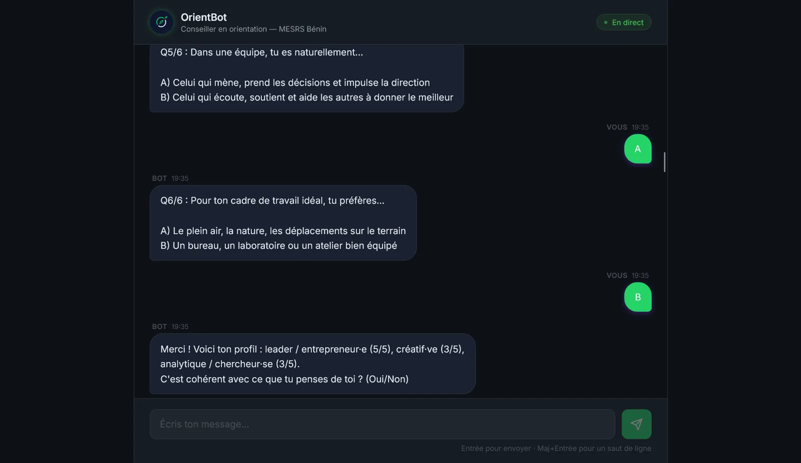
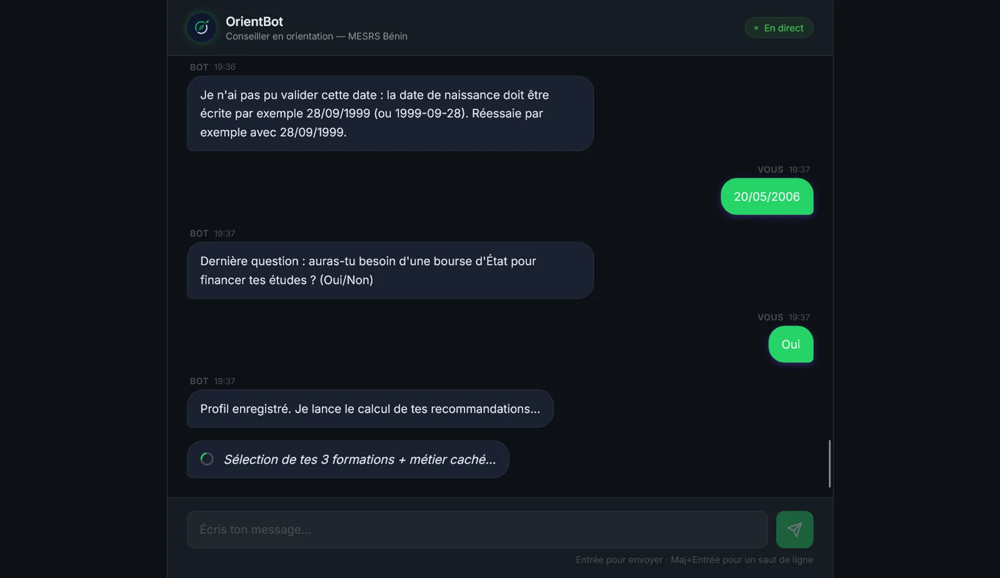
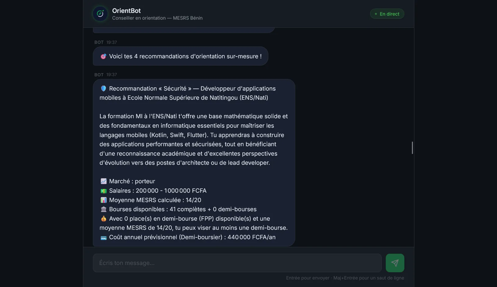
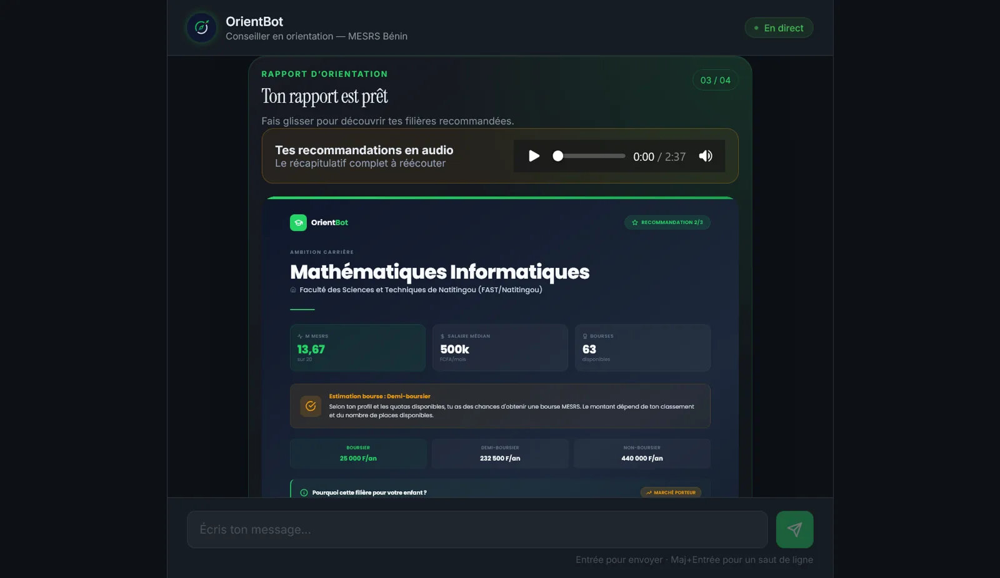

# OrientBot

> An AI career-guidance web app that helps Beninese high-school graduates choose a university program and a career, and estimate their chances of a state scholarship.

🎥 **Demo video (90 s):** [Watch OrientBot in action](https://res.cloudinary.com/dtwx8br7o/video/upload/v1784879713/OrientBot_90s_V5_jfyc5v.mp4)

## The problem
Every year, Beninese baccalauréat holders must pick a university program with little guidance, often based on family pressure rather than their real profile. State scholarships and half-scholarships depend on quotas and thresholds set by the Ministry of Higher Education (MESRS), which most students and parents find hard to read. Parents, who usually pay, rarely get a clear document to support the decision.

## What it does
- Builds the student's profile through a guided chat: bac grades, favourite subjects, a short RIASEC-style cognitive test, career aspirations and expected salary.
- Recommends 3 programs and careers, explained in French voice notes, with a scholarship / half-scholarship simulation based on the official MESRS guide.
- Generates a detailed PDF report (with an audio summary) that the student can forward to their parents.
- Admin dashboard to follow conversations and student profiles.

## Screenshots
| RIASEC-style cognitive test | Profile and scholarship question |
|---|---|
|  |  |
| **Personalised recommendations** | **Orientation report with audio summary** |
|  |  |

## Tech stack
- **Interface:** web chat app in Astro + Tailwind CSS · admin dashboard in Next.js + TanStack Query
- **Backend:** Node.js, Express, TypeScript, Drizzle ORM
- **LLM:** Groq (`openai/gpt-oss-120b`) via the Vercel AI SDK, OpenRouter as fallback
- **RAG:** BGE-M3 embeddings (self-hosted Infinity server) + pgvector, over the MESRS orientation guide and 100+ career sheets for West Africa
- **Voice:** Deepgram Aura TTS (French) for audio recommendations
- **Data:** Supabase (PostgreSQL + pgvector)
- **Payments:** KKiaPay (Mobile Money)

## Status
- [x] Live web app with the full guidance flow and scholarship simulation
- [x] PDF reports and voice notes
- [x] Launched: 7 paying customers out of 184 landing page visitors
- [x] Landing page: [orientbot.sinda.pro](https://orientbot.sinda.pro/)

## Source code
The source code is private for commercial reasons. Access can be provided on request for evaluation purposes.

## Contact
Arès GNIMAGNON, Founder & CEO of [SINDA SARL](https://www.sinda.pro/) · [LinkedIn](https://bj.linkedin.com/in/ar%C3%A8s-gnimagnon-a239353b8/) · [aresgnimagnon0@gmail.com](mailto:aresgnimagnon0@gmail.com)
